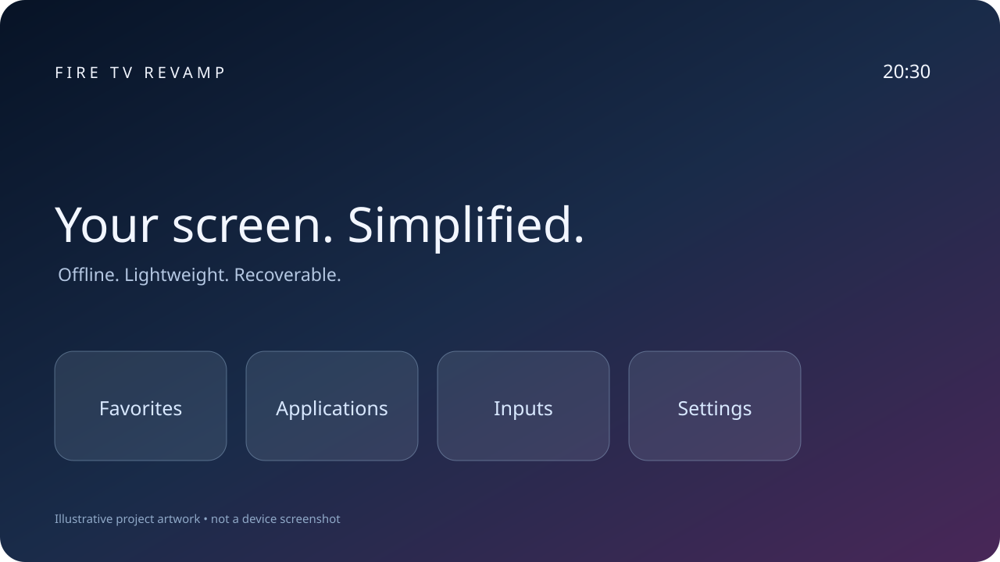

# Fire TV Revamp



A lightweight, offline Fire TV launcher with glass-style cards, a customizable dock, hidden apps, clock controls and recovery access to Amazon Home. Includes a read-only ADB audit utility inspired by CleanYourTV.

**An Android app, not replacement firmware.** Amazon Home remains installed and enabled. Optional accessibility redirection is experimental and can be interrupted by Fire OS updates. No root, network blocking or system debloat runs automatically.

## Coming from YouTube?

Read the [viewer quick start](docs/youtube-viewers.md), [wallpaper details](docs/wallpapers.md), and [planned enhancements](docs/roadmap.md). The video shows a personal build; the public preview uses original static artwork and does not include live wallpaper.

## Try it

Download the APK and SHA256SUMS from [Releases](https://github.com/aashish-26/firetv-revamp/releases). Android 8 / API 26 minimum; Android 9 / Fire OS 7 is the primary development target.

```sh
adb -s YOUR_TV_IP:5555 install firetv-revamp-0.1.0.apk
adb -s YOUR_TV_IP:5555 shell am start -n io.github.aashish26.firetvrevamp/com.gathin.tvhome.MainActivity
```

Installation alone does not change Home behavior. Test Settings, remote, HDMI, audio and your streaming apps first. Enable the optional **Fire TV Revamp / Home screen** accessibility service through normal TV Settings only if your firmware exposes it. Do not force protected settings or disable Amazon Home.

The earlier personal launcher was tested on Redmi AFTMV00 / dahlia, Fire OS 7.7.1.7. This separately packaged public preview has build/lint/unit validation, not a complete physical device certification. Other models and firmware are unverified. No measured speed improvement is claimed.

## Safety tools

```sh
python3 tools/audit.py --serial YOUR_TV_IP:5555 --out backups/my-tv
```

Requires Python 3 and ADB. Collects local diagnostics without changing the TV. Backups can contain sensitive information: never upload them. Package-state snapshots are not firmware backups. No universal disable list is shipped: package dependencies differ between models.

## Build

Install JDK 17 and Android SDK platform/build-tools 34. Set `ANDROID_HOME` to your SDK, then:

```sh
cd launcher
./gradlew --no-watch-fs assembleDebug lintDebug testDebugUnitTest
```

Release signing keys are never committed. Community releases use a separate identity/key from the personal Clean TV build and can coexist; preferences and accessibility setup do not migrate automatically. See [recovery](docs/recovery.md), [compatibility](docs/compatibility.md), and [credits](NOTICE).

## License

Code: MIT, with upstream copyright retained. Outfit and Open Sans: SIL OFL (licenses/). Preview artwork is original project artwork. No anime wallpapers, streaming apps, brand-logo packs, personal backups or private signing keys are included.
