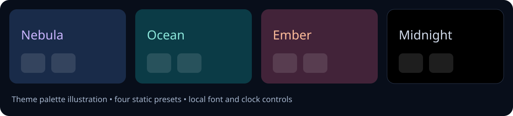
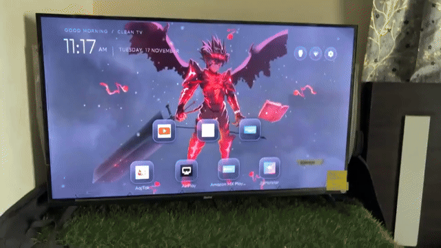

# Fire TV Revamp


A lightweight, offline Fire TV launcher with glass-style cards, a customizable dock, hidden apps, clock controls and recovery access to Amazon Home. Includes a read-only ADB audit utility inspired by CleanYourTV.

**An Android app, not replacement firmware.** Amazon Home remains installed and enabled. Optional accessibility redirection is experimental and can be interrupted by Fire OS updates. No root, network blocking or system debloat runs automatically.

## Start here

| I want to… | Go to |
|---|---|
| Install on macOS / Linux | [Easy installation](#easy-installation--macos--linux) |
| Check my TV without installing | `bash scripts/install.sh --check` |
| Change themes, fonts or controls | [Customization guide](docs/customization.md) |
| Understand what is included | [Feature status](docs/features.md) |
| Fix connection or installation problems | [Troubleshooting](docs/troubleshooting.md) |
| Return to Amazon Home | [Recovery guide](docs/recovery.md) |
| Suggest an improvement | [Open an issue](https://github.com/aashish-26/firetv-revamp/issues/new/choose) |

**New in 0.2.0:** four static themes with matching greeting accents, three font choices, dedicated **Style** and **Apps** buttons, and a visual-reset action that leaves your dock and Home redirect preferences alone.



## Coming from YouTube?

Read the [viewer quick start](docs/youtube-viewers.md), [wallpaper details](docs/wallpapers.md), and [planned enhancements](docs/roadmap.md). The video shows a personal build; the public preview uses original static artwork and does not include live wallpaper.

## Easy installation — macOS / Linux

Requires **Python 3** and **ADB** on your computer. Java and the Android SDK are not needed for the published APK. Enable ADB debugging on the TV and accept your computer's authorization prompt.

Download this repository using **Code → Download ZIP**, unzip it, open Terminal in that folder, and run:

```sh
bash scripts/install.sh
```

Or, if Git is installed:

```sh
git clone https://github.com/aashish-26/firetv-revamp.git
cd firetv-revamp
bash scripts/install.sh
```

The installer checks dependencies, lists authorized devices for selection, offers an ADB connection prompt if needed, downloads the pinned release, verifies both the published SHA-256 checksum and the built-in expected hash, and asks before installing. If this community app is already installed, it backs up its APK(s) first. An optional final prompt opens the launcher.

For an already connected device:

```sh
bash scripts/install.sh --serial YOUR_TV_IP:5555
```

No automatic dependency installation, reboot, Home redirection, system debloating or protected settings changes. Installation records and prior APKs stay locally under ignored `backups/install-*/`. See the [installation and rollback guide](docs/installation.md).

Prefer manual installation or use Windows? Download the APK and SHA256SUMS from [Releases](https://github.com/aashish-26/firetv-revamp/releases), [verify the checksum](docs/youtube-viewers.md), then:

```sh
adb -s YOUR_TV_IP:5555 install -r firetv-revamp-0.2.0.apk
adb -s YOUR_TV_IP:5555 shell am start -n io.github.aashish26.firetvrevamp/com.gathin.tvhome.MainActivity
```

Android API 26 minimum; Android 9 / Fire OS 7 is the primary development target.

Installation alone does not change Home behavior. Test Settings, remote, HDMI, audio and your streaming apps first. Enable the optional **Fire TV Revamp / Home screen** accessibility service through normal TV Settings only if your firmware exposes it. Do not force protected settings or disable Amazon Home.

The earlier personal launcher was tested on Redmi AFTMV00 / dahlia, Fire OS 7.7.1.7. This separately packaged public preview has build/lint/unit validation, not a complete physical device certification. Other models and firmware are unverified. No measured speed improvement is claimed.

## Personal setup showcase



[Watch the short MP4 demo](docs/showcase/personal-setup-demo.mp4) · [View still image](docs/showcase/personal-setup.jpg)

This user-supplied recording shows the **personal Clean TV setup**, including its anime video wallpaper. The downloadable community v0.2.0 APK uses a static Nebula/Midnight theme and does not include these wallpaper files or video playback. This demo is not a performance benchmark. [Showcase details and media terms](docs/showcase/README.md).

## Safety tools — separate and opt-in

```sh
python3 tools/audit.py --serial YOUR_TV_IP:5555 --out backups/my-tv
```

Requires Python 3 and ADB. Collects local diagnostics without changing the TV. Backups can contain sensitive information: never upload them. Package-state snapshots are not firmware backups. No universal disable list is shipped: package dependencies differ between models.

## Build

Install JDK 17 and Android SDK platform/build-tools 34. Set `ANDROID_HOME` to your SDK, then:

```sh
cd launcher
./gradlew --no-watch-fs assembleDebug lintDebug testDebugUnitTest
```

Release signing keys are never committed. Community releases use a separate identity/key from the personal Clean TV build and can coexist; preferences and accessibility setup do not migrate automatically. See [recovery](docs/recovery.md), [compatibility](docs/compatibility.md), and [credits](NOTICE).

## License

Code: MIT, with upstream copyright retained. Outfit and Open Sans: SIL OFL (licenses/). Preview artwork is original project artwork. No standalone anime wallpaper files, streaming apps, brand-logo packs, personal backups or private signing keys are included. The showcase depicts a personal anime wallpaper; its third-party content is excluded from the MIT license.
